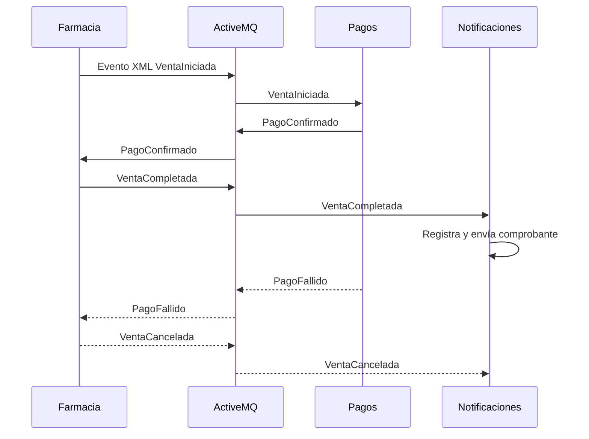

# Coreografía de venta de farmacia

La venta usa eventos pub/sub en ActiveMQ. Farmacia reserva stock y publica `VentaIniciada`; Pagos responde con `PagoConfirmado` o `PagoFallido`; Farmacia confirma o compensa; Notificaciones escucha el resultado.



## Contrato de evento

```xml
<Evento>
	<tipo>VentaCompletada</tipo>
	<codigoVenta>VFA-2026-AB12</codigoVenta>
	<idPropietario>105</idPropietario>
</Evento>
```

Farmacia publica XML como mensaje de texto para que PHP/STOMP pueda consumirlo. Los topics son `topic.VentaIniciada`, `topic.PagoConfirmado`, `topic.PagoFallido`, `topic.VentaCompletada` y `topic.VentaCancelada`.
