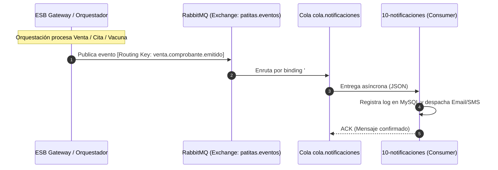

# 🐇 Coreografía de Eventos de Dominio — Clínica Veterinaria Patitas Alegre

Este directorio documenta la arquitectura orientada a eventos (**Event-Driven Architecture / Coreografía**) que opera mediante el Message Broker **RabbitMQ** (con exchange tipo `topic`) y el **ESB Gateway**.

---

## 🏛️ 1. Infraestructura del Broker

- **Broker:** RabbitMQ 3.x (con plugin de administración web)
- **Host / Puertos:**
  - `amqp://localhost:5672` (Protocolo AMQP para microservicios y ESB)
  - `http://localhost:15672` (Consola de administración web - credenciales: `guest` / `guest`)
- **Exchange Principal:**
  - **Nombre:** `patitas.eventos`
  - **Tipo:** `topic`
  - **Durable:** `true`

---

## 📡 2. Eventos de Dominio Publicados

| Routing Key | Emisor | Payload Principal | Consumidores Típicos |
| :--- | :--- | :--- | :--- |
| `venta.comprobante.emitido` | ESB Gateway / Farmacia / Pagos | `{ tipo: "COMPROBANTE_ELECTRONICO", destinatario, mensaje, hashCdr, serieCorrelativo }` | `cola.notificaciones` (Servicio 10) |
| `cita.creada` | 07-citas / ESB | `{ tipo: "CITA_PROGRAMADA", idCita, idPropietario, idMascota, fecha, hora, email }` | `cola.notificaciones` (Email / SMS) |
| `vacuna.recordatorio` | 04-mascotas / ESB | `{ tipo: "RECORDATORIO_VACUNA", idMascota, nombreMascota, vacuna, fechaVencimiento }` | `cola.notificaciones` (WhatsApp / Email) |

---

## 🔄 3. Diagrama General de Coreografía

---

## 📂 4. Casos de Uso Detallados
1. [`venta-farmacias-coreografia.md`](file:///c:/PatitasAlegres/PatitasAlegre-main/coreografia/venta-farmacias-coreografia.md): Emisión de comprobante en SUNAT, compensación Saga y notificación asíncrona.
2. [`recordatorio-vacuna-coreografia.md`](file:///c:/PatitasAlegres/PatitasAlegre-main/coreografia/recordatorio-vacuna-coreografia.md): Alertas automáticas para revacunación canina y felina.
3. [`resultado-laboratorio-coreografia.md`](file:///c:/PatitasAlegres/PatitasAlegre-main/coreografia/resultado-laboratorio-coreografia.md): Publicación de diagnósticos e informes médicos.
