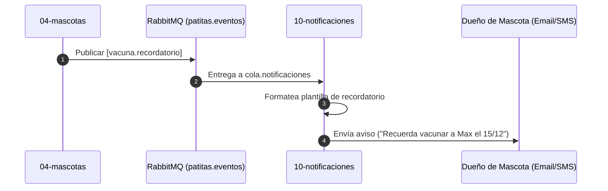

# 💉 Coreografía: Recordatorio de Vacunación

Describe la publicación asíncrona de recordatorios de vacunación para pacientes de la clínica veterinaria.

---

## 1. Flujo del Evento

Cuando el médico veterinario en `04-mascotas` o `05-personal` registra la aplicación de una vacuna (por ejemplo: Rabia, Óctuple, Triple Felina) y calcula la fecha de refuerzo, se dispara el evento de dominio a RabbitMQ:

- **Exchange:** `patitas.eventos` (topic)
- **Routing Key:** `vacuna.recordatorio`
- **Cola Suscrita:** `cola.notificaciones` (Servicio 10)



---

## 2. Contrato JSON del Evento

```json
{
  "tipo": "RECORDATORIO_VACUNA",
  "idMascota": 42,
  "nombreMascota": "Bobby",
  "nombrePropietario": "Carlos Ramírez",
  "destinatario": "carlos.ramirez@gmail.com",
  "vacuna": "Antirrábica Anual",
  "fechaAplicacion": "2026-11-19",
  "fechaRefuerzo": "2027-11-19",
  "mensaje": "Estimado Carlos, Bobby necesita su refuerzo de vacuna Antirrábica en la Clínica Patitas Alegre."
}
```
