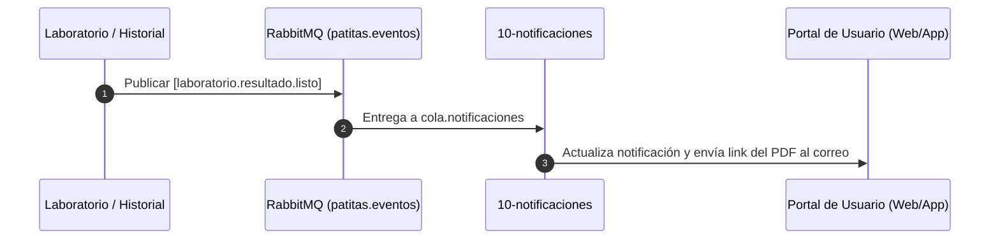

# 🔬 Coreografía: Resultado de Laboratorio Clínico

Describe la notificación automática a dueños y veterinarios cuando un examen clínico o análisis de sangre es completado.

---

## 1. Flujo del Evento

- **Exchange:** `patitas.eventos`
- **Routing Key:** `laboratorio.resultado.listo`
- **Cola Suscrita:** `cola.notificaciones`



---

## 2. Contrato JSON del Evento

```json
{
  "tipo": "RESULTADO_LABORATORIO",
  "idExamen": 108,
  "idMascota": 15,
  "nombreMascota": "Luna",
  "destinatario": "maria.torres@gmail.com",
  "tipoExamen": "Hemograma Completo + Bioquímica",
  "urlPdf": "https://clinica.patitasalegre.pe/resultados/HEM-2026-108.pdf",
  "mensaje": "Los resultados de laboratorio de Luna ya están disponibles para su consulta."
}
```
