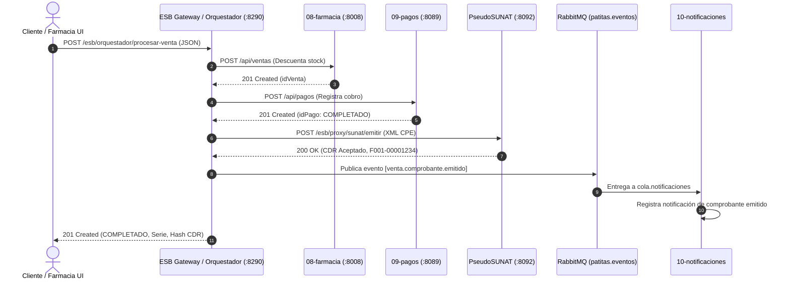
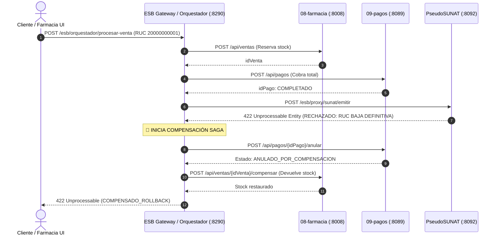

# 💊 Coreografía y Patrón Saga: Venta de Farmacia y Facturación SUNAT

Este flujo implementa el patrón **Saga con Compensación** orquestado por el **ESB Gateway**, junto con coreografía de eventos asíncrona mediante **RabbitMQ** (`patitas.eventos`).

---

## 🔄 1. Diagrama de Secuencia: Flujo Feliz



---

## ⚠️ 2. Diagrama de Secuencia: Compensación Saga (Rollback en Vivo)

Si el cliente envía un RUC en estado **BAJA DEFINITIVA** (ej. `20000000001`) o el servicio de SUNAT rechaza el comprobante:



---

## 📋 3. Contrato del Evento publicado en RabbitMQ

- **Routing Key:** `venta.comprobante.emitido`
- **Payload:**
```json
{
  "tipo": "COMPROBANTE_ELECTRONICO",
  "destinatario": "cliente@patitasalegre.pe",
  "mensaje": "Su comprobante F001-00001234 por S/ 150.00 fue aceptado por SUNAT.",
  "hashCdr": "cpe-hash-a1b2c3d4e5f67890"
}
```
