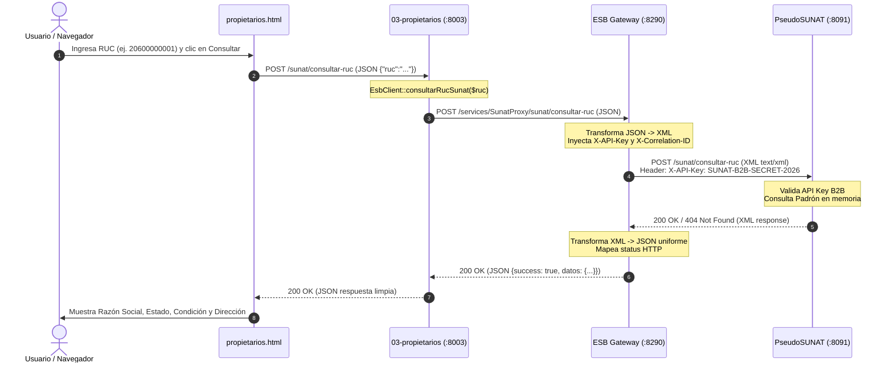

# Integración B2B Consulta RUC (PseudoSUNAT) vía ESB Gateway

Este documento detalla la arquitectura desacoplada y el flujo de integración B2B para la consulta tributaria de RUC en la **Clínica Veterinaria Patitas Alegre**.

---

## 🏛️ 1. Arquitectura de Desacoplamiento SOA

La lógica de consulta tributaria ha sido extraída por completo del servicio interno `03-propietarios` y encapsulada en un servicio externo autónomo (**PseudoSUNAT**). La comunicación se realiza de forma mediada y segura a través del **ESB Gateway**:

- **PseudoSUNAT** (`puerto 8091`): Servicio B2B externo independiente en PHP nativo. Expone su propio contrato en XML (`POST /sunat/consultar-ruc`) protegido mediante cabecera `X-API-Key`. No tiene acceso ni dependencias con la base de datos ni con las clases de Patitas Alegre.
- **ESB Gateway** (`puerto 8290`): Mediador de integración SOA implementado en Node.js Express. Recibe peticiones JSON desde servicios autorizados, inyecta credenciales B2B (`SUNAT-B2B-SECRET-2026`) y trazabilidad (`X-Correlation-ID`), transforma JSON a XML y viceversa.
- **03-propietarios** (`puerto 8003`): Servicio interno que actúa exclusivamente como consumidor del ESB mediante `EsbClient.php`. No conoce la IP, puerto ni contrato XML de PseudoSUNAT.
- **Frontend** (`propietarios.html`): Interfaz de usuario que consume `http://localhost:8003/sunat/consultar-ruc` en formato JSON, manteniéndose completamente agnóstico de los cambios de arquitectura subyacentes.

---

## 🔄 2. Diagrama de Secuencia B2B



---

## ⚙️ 3. Componentes y Contratos

### 3.1 PseudoSUNAT (`PatitasAlegres/PseudoSunat` o `C:\ProyectosSOA\PseudoSUNAT`)
- **Puerto:** `8091`
- **Punto de Entrada:** `public/index.php` con enrutador `public/router.php`
- **Seguridad B2B:** Cabecera obligatoria `X-API-Key: SUNAT-B2B-SECRET-2026`
- **Padrón Demo:**
  - `20600000001`: VETERINARIA HUELLITAS DEL SUR S.A.C. (ACTIVO / HABIDO)
  - `20100000002`: COMERCIAL PATITAS ALEGRES E.I.R.L. (SUSPENSION TEMPORAL / NO HABIDO)
- **Contrato XML Request:**
  ```xml
  <?xml version="1.0" encoding="UTF-8"?>
  <consultarRucRequest>
      <ruc>20600000001</ruc>
  </consultarRucRequest>
  ```
- **Contrato XML Response (Éxito):**
  ```xml
  <?xml version="1.0" encoding="UTF-8"?>
  <consultarRucResponse>
      <success>true</success>
      <mensaje>Consulta simulada correctamente...</mensaje>
      <datos>
          <ruc>20600000001</ruc>
          <razon_social>VETERINARIA HUELLITAS DEL SUR S.A.C. (DEMO)</razon_social>
          <estado>ACTIVO</estado>
          <condicion>HABIDO</condicion>
          <direccion>AV. EJEMPLO 123, AREQUIPA - AREQUIPA</direccion>
          <tipo_contribuyente>SOCIEDAD ANONIMA CERRADA</tipo_contribuyente>
          <actividad_economica>ACTIVIDADES VETERINARIAS</actividad_economica>
          <origen>PADRON SIMULADO</origen>
      </datos>
  </consultarRucResponse>
  ```

### 3.2 ESB Gateway (`PatitasAlegre-main/services/esb-gateway`)
- **Puerto:** `8290`
- **Ruta Proxy:** `POST /services/SunatProxy/sunat/consultar-ruc`
- **Configuración:** `config/esb-endpoints.json` y `config/puertos.json`
- **Payload Entrada:** `{"ruc": "20600000001"}`
- **Respuesta Salida (JSON):**
  ```json
  {
    "success": true,
    "modo": "B2B-ESB",
    "mensaje": "Consulta simulada correctamente...",
    "datos": {
      "ruc": "20600000001",
      "razon_social": "VETERINARIA HUELLITAS DEL SUR S.A.C. (DEMO)",
      "estado": "ACTIVO",
      "condicion": "HABIDO",
      "direccion": "AV. EJEMPLO 123, AREQUIPA - AREQUIPA",
      "tipo_contribuyente": "SOCIEDAD ANONIMA CERRADA",
      "actividad_economica": "ACTIVIDADES VETERINARIAS",
      "origen": "PADRON SIMULADO"
    }
  }
  ```

### 3.3 Microservicio 03-Propietarios (`services/03-propietarios`)
- **Puerto:** `8003`
- **Cliente:** `src/Services/EsbClient.php` método `consultarRucSunat(string $ruc)`
- **Controlador:** `src/Controllers/PropietarioController.php` delega la petición vía cURL al ESB Gateway.

---

## 🧪 4. Guía de Pruebas

### 4.1 Iniciar los Servicios Necesarios
Abre tres terminales:

1. **PseudoSUNAT:**
   ```powershell
   cd PatitasAlegres\PseudoSunat
   php -S localhost:8091 -t public public/router.php
   ```

2. **ESB Gateway:**
   ```powershell
   cd PatitasAlegres\PatitasAlegre-main\services\esb-gateway
   npm start
   ```

3. **03-Propietarios:**
   ```powershell
   cd PatitasAlegres\PatitasAlegre-main\services\03-propietarios
   php -S localhost:8003 -t public public/router.php
   ```

### 4.2 Prueba Directa B2B a PseudoSUNAT (XML con X-API-Key)
```powershell
Invoke-RestMethod -Uri "http://localhost:8091/sunat/consultar-ruc" `
  -Method Post `
  -Headers @{ "X-API-Key" = "SUNAT-B2B-SECRET-2026" } `
  -ContentType "text/xml" `
  -Body '<?xml version="1.0" encoding="UTF-8"?><consultarRucRequest><ruc>20600000001</ruc></consultarRucRequest>'
```

### 4.3 Prueba al ESB Gateway (JSON)
```powershell
Invoke-RestMethod -Uri "http://localhost:8290/services/SunatProxy/sunat/consultar-ruc" `
  -Method Post `
  -ContentType "application/json" `
  -Body '{"ruc":"20600000001"}'
```

### 4.4 Prueba Integral desde 03-Propietarios (Consumido por Frontend)
```powershell
Invoke-RestMethod -Uri "http://localhost:8003/sunat/consultar-ruc" `
  -Method Post `
  -ContentType "application/json" `
  -Body '{"ruc":"20600000001"}'
```

### 4.5 Prueba en Interfaz de Usuario
Abre `frontend/usuario/propietarios.html` en el navegador, ingresa `20600000001` y verifica la presentación de la información en el panel **Consulta de RUC · SUNAT (Demo)**.
